# Capstone 2: Keep It Running (Robot Shop Observability)

Author: Nwafor Obinna
Repo: https://github.com/Balor44/robot-shop

This project takes the Robot Shop microservices demo (a fork of instana/robot-shop) and makes it observable: metrics, logs, traces, an SLO with an error budget alert, and a blameless incident postmortem.

## Environment

* Local Kubernetes cluster using `kind` (cluster name: `capstone`)
* Robot Shop deployed with its Helm chart into the `robot-shop` namespace
* Instana agent settings removed from the chart, since we use an open source stack instead
* Observability stack: Prometheus, Grafana and Alertmanager (kube-prometheus-stack), Blackbox Exporter, Loki, Fluent Bit, Jaeger and the OpenTelemetry Collector

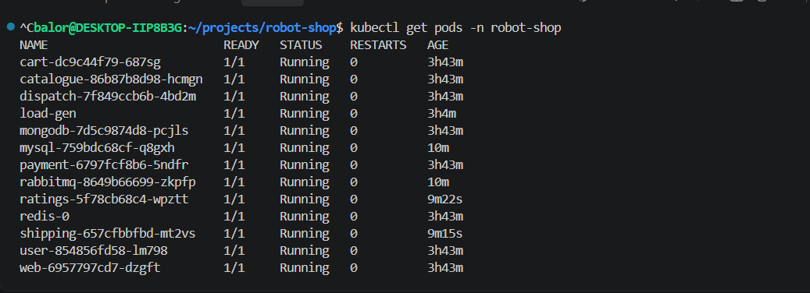

*All Robot Shop pods in the Running state.*

## Architecture

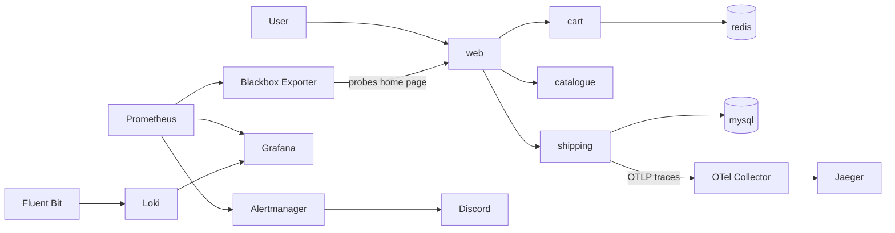

## Repository layout

```
observability/
  probe-web.yaml              Blackbox probe of the web home page
  dashboards/robot-shop.json  Grafana dashboard as code
  loki-values.yaml            Loki Helm values
  fluent-bit-values.yaml      Fluent Bit Helm values
  loki-datasource.yaml        Loki datasource for Grafana
  tracing.yaml                Jaeger and OpenTelemetry Collector
  slo-rules.yaml              SLO recording rules and burn rate alert
  alertmanager-discord.yaml   Alertmanager route to Discord
K8s/helm/templates/
  shipping-deployment.yaml    Shipping service with the OpenTelemetry Java agent
docs/
  postmortem-redis-outage.md  Incident postmortem
  screenshots/                Evidence for each step
```

## 1. Metrics and dashboard

Prometheus and Grafana come from the `kube-prometheus-stack` Helm chart. Robot Shop does not expose general request metrics, so the SLI is built from a Blackbox Exporter probe that checks the web home page. The dashboard has three panels:

* Availability: `avg_over_time(probe_success[5m])`
* Errors: `1 - avg_over_time(probe_success[5m])`
* Latency: `probe_duration_seconds`

The dashboard JSON is stored in Git and loaded into Grafana through a ConfigMap labelled `grafana_dashboard=1`, so it can be rebuilt from code.

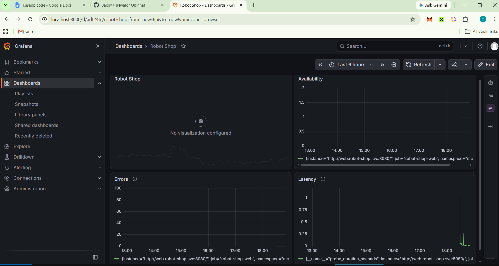

*The Robot Shop dashboard with availability, errors and latency.*

## 2. Logs

Fluent Bit collects container logs from every pod and ships them to Loki. Grafana reads Loki as a datasource, so logs are searchable next to the metrics.

Example queries:

```
{namespace="robot-shop"}
{namespace="robot-shop", service="cart"}
{namespace="robot-shop"} |~ "(?i)error"
```

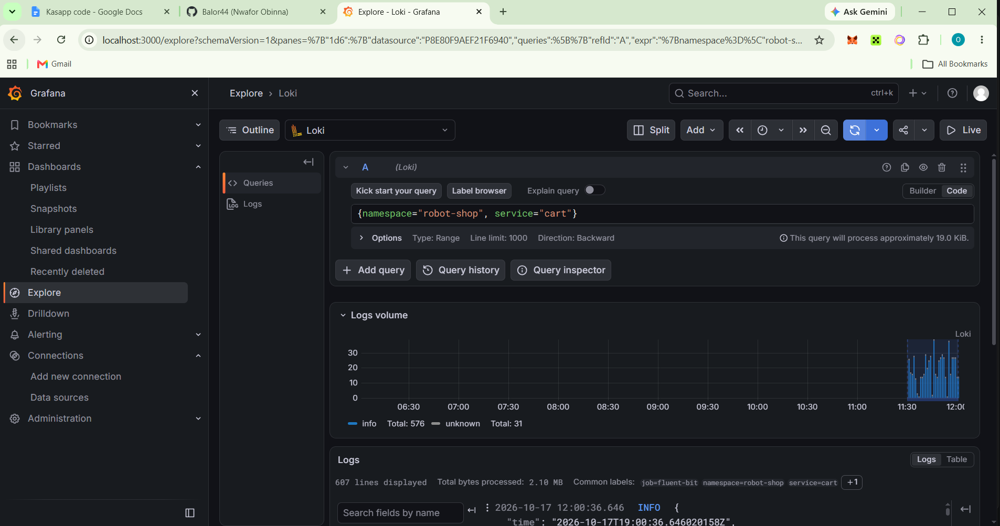

*Logs from the robot-shop namespace.*

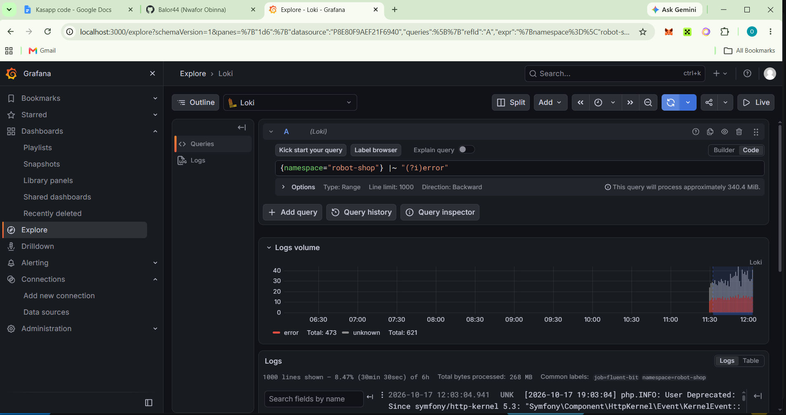

*Searching for error lines across services.*

## 3. Traces

The `shipping` service is a Java app, so it is instrumented with the OpenTelemetry Java agent without rebuilding the image. An init container downloads the agent jar into a shared volume, and `JAVA_TOOL_OPTIONS` loads it at startup. Traces go to an OpenTelemetry Collector, which forwards them to Jaeger.

Only `shipping` is instrumented. The other services use Node.js, Python, Go and PHP and would each need their own instrumentation.

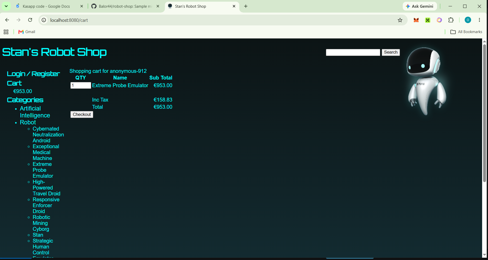

*Traffic used to generate traces.*

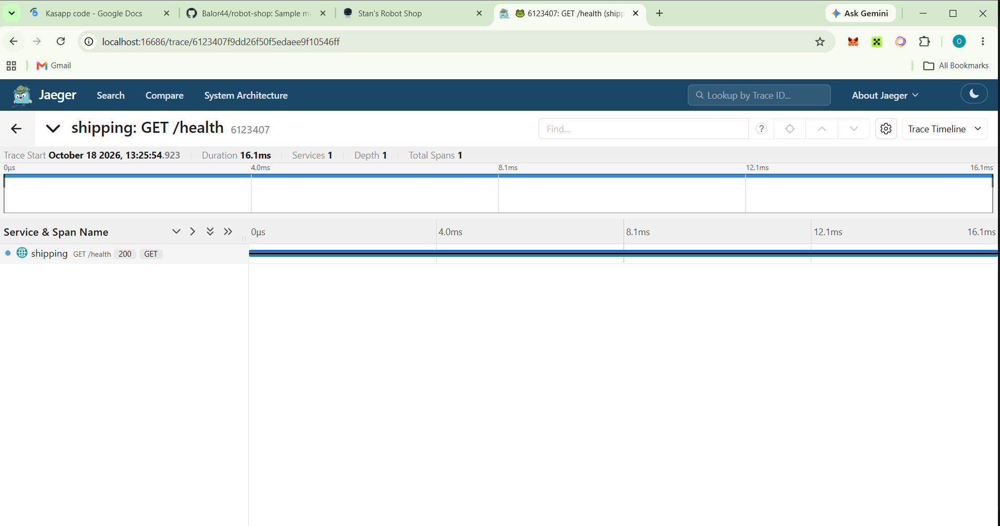

*A trace for the shipping service in Jaeger.*

## 4. SLO and error budget

| Item | Value |
| --- | --- |
| SLI | Share of successful probes of the web home page (`probe_success`) |
| SLO | 99% availability over 30 days |
| Error budget | 1% of probes may fail, about 7.2 hours per 30 days |
| Alert | `RobotShopErrorBudgetBurn` fires when the 5 minute error rate is above 14.4 times the budget (14.4%) for 2 minutes |

The 14.4 multiplier is the standard fast burn threshold: at that rate a 30 day budget would be gone in about 2 days.

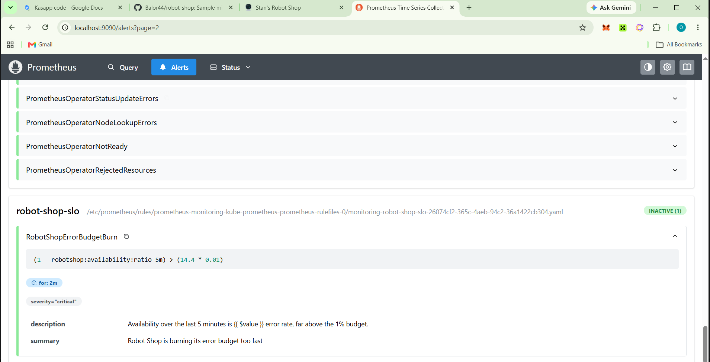

*The alert rule loaded in Prometheus.*

### Alert test

To prove the alert works, the `web` deployment was scaled to zero. The alert went from pending to firing and Alertmanager sent a message to Discord. After scaling `web` back to one replica, a resolved message arrived.

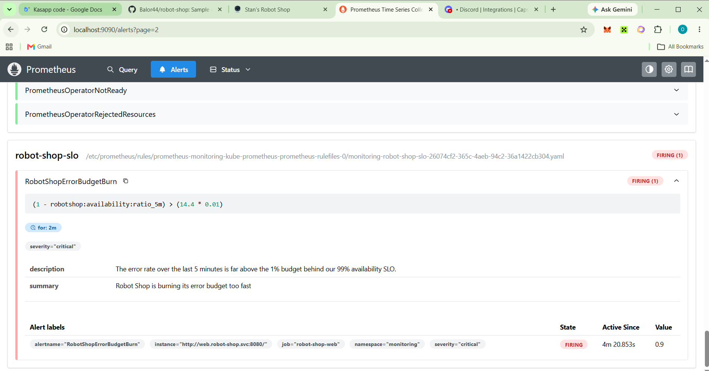

*The alert in the firing state.*

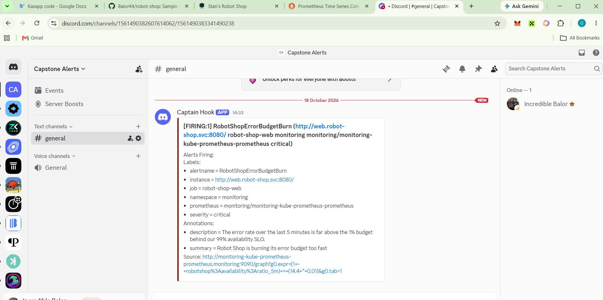

*The alert delivered to Discord.*

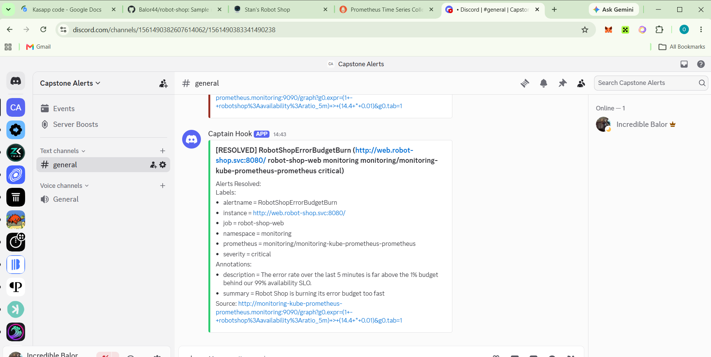

*The resolved notification after recovery.*

The Discord webhook URL is stored in a Kubernetes Secret created by hand. It is not committed to Git.

## 5. Incident drill: Redis outage

The Redis StatefulSet was scaled to zero to simulate a failure. The full write up is in [docs/postmortem-redis-outage.md](docs/postmortem-redis-outage.md).

Short version:

* Before: adding an item to the cart returned success.

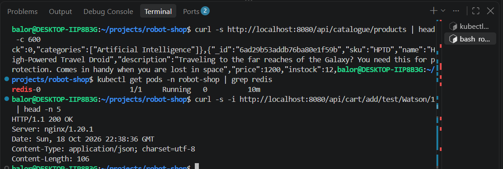

* During: adding an item failed because the cart service could not reach Redis.

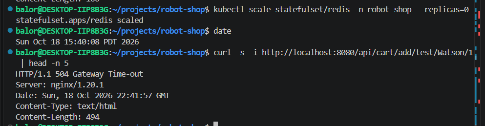

* Detection: the errors were found in Loki using the cart error query.

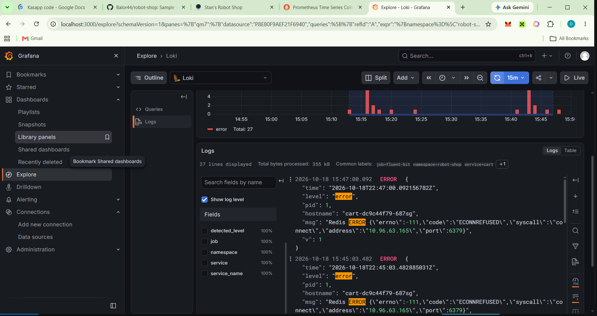

* Monitoring gap: the dashboard stayed healthy during the incident, because the probe only checks the home page.

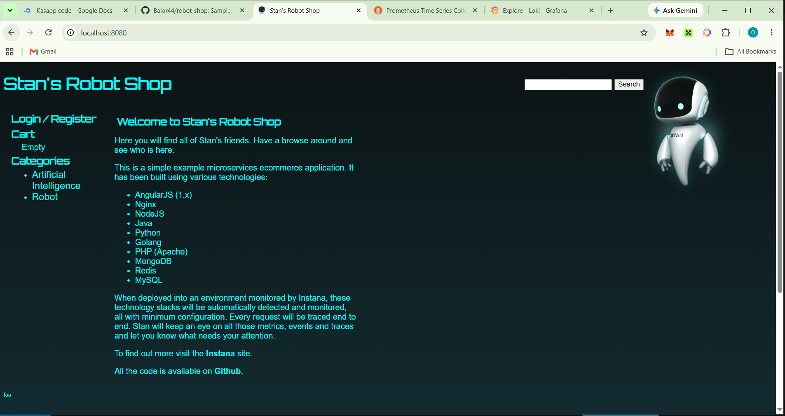

* Mitigation: scaling Redis back to one replica restored the cart.

Key lesson: an SLI built only on the home page can say everything is fine while a core feature is down. The first action item is a probe that checks a cart endpoint.

## How to rebuild this from scratch

```
kind create cluster --name capstone
helm install robot-shop K8s/helm -n robot-shop --create-namespace
helm install monitoring prometheus-community/kube-prometheus-stack -n monitoring --create-namespace
helm install blackbox prometheus-community/prometheus-blackbox-exporter -n monitoring
kubectl apply -f observability/probe-web.yaml
kubectl create configmap robot-shop-dashboard -n monitoring --from-file=observability/dashboards/robot-shop.json
kubectl label configmap robot-shop-dashboard -n monitoring grafana_dashboard=1
helm install loki grafana-community/loki -n loki --create-namespace -f observability/loki-values.yaml
helm install fluent-bit fluent/fluent-bit -n loki -f observability/fluent-bit-values.yaml
kubectl apply -f observability/loki-datasource.yaml
kubectl apply -f observability/tracing.yaml
kubectl apply -f observability/slo-rules.yaml
kubectl create secret generic discord-webhook -n monitoring --from-literal=url='<your webhook URL>'
kubectl apply -f observability/alertmanager-discord.yaml
```

## Known issues and notes

* The kind node inherited a very large open files limit, which made MySQL and RabbitMQ get killed for running out of memory at startup. The fix was to set `LimitNOFILE=1048576` for containerd inside the kind node. This has to be repeated if the cluster is recreated.
* Robot Shop does not expose general request metrics, so there is no requests per second panel. The SLI uses the Blackbox probe instead.
* Tracing covers the `shipping` service only.
* Alerts go to Discord instead of Slack, because no Slack workspace was available.
* Robot Shop runs Redis as a single replica StatefulSet, which is the weak point exposed by the drill.
